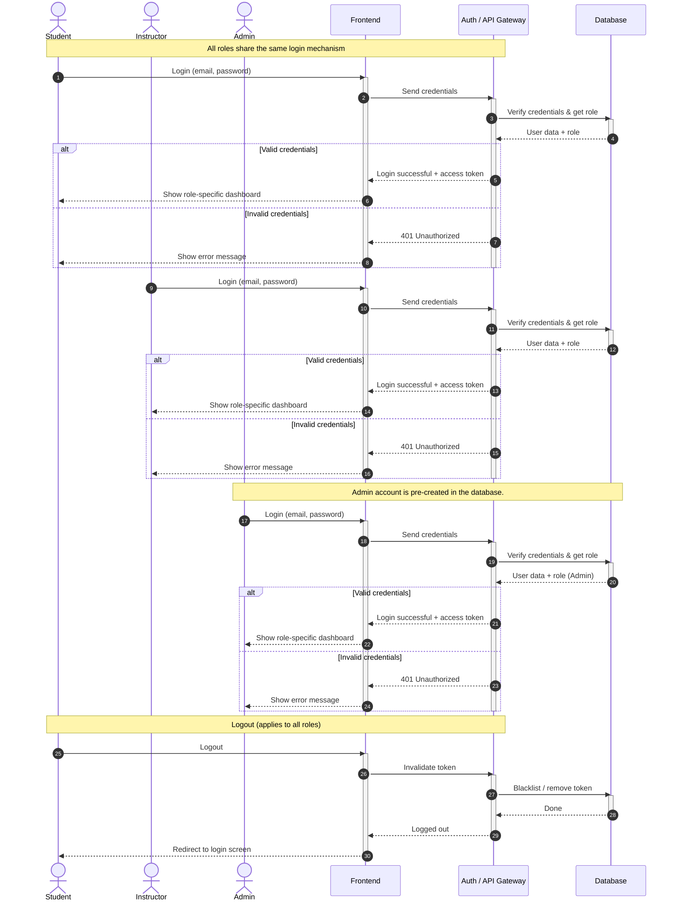
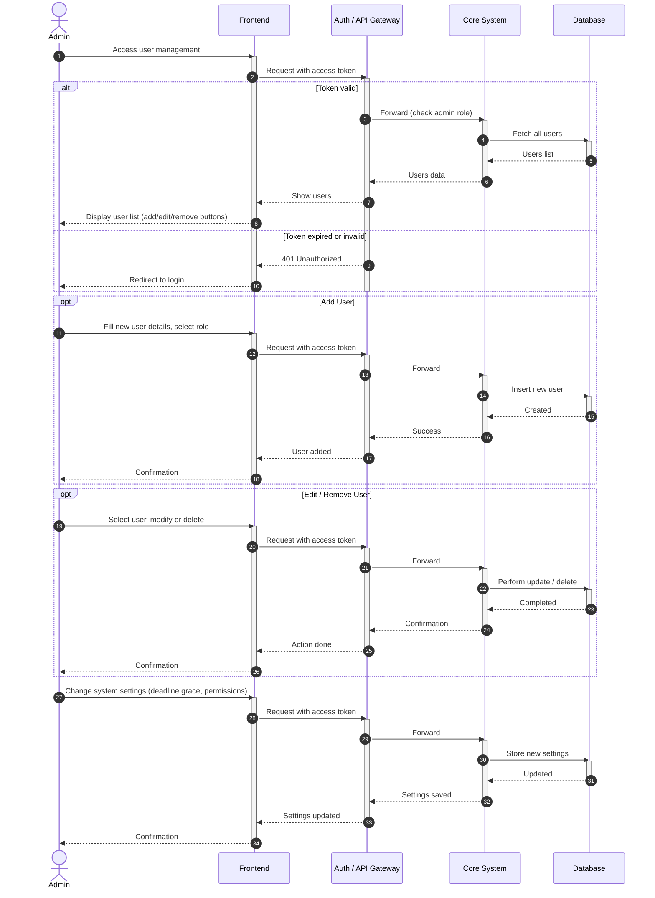
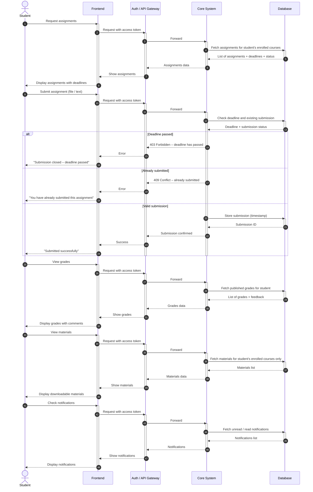

# Sequence Diagram — Split by Section

---

## Section 1 — Login & Logout

---

## Section 2 — Admin: User Management & Settings

---

## Section 3 — Admin: Course Management

```mermaid
sequenceDiagram
    autonumber
    actor Admin
    participant UI as Frontend
    participant Auth as Auth / API Gateway
    participant System as Core System
    participant DB as Database
    participant Notify as Notification Service

    Admin->>UI: Access course management
    activate UI
    UI->>Auth: Request with access token
    activate Auth
    Auth->>System: Forward (check admin role)
    activate System
    System->>DB: Fetch all courses
    activate DB
    DB-->>System: Courses list
    deactivate DB
    System-->>Auth: Courses data
    deactivate System
    Auth-->>UI: Show courses
    deactivate Auth
    UI-->>Admin: Display courses with management options
    deactivate UI

    opt Create Course
        Admin->>UI: Fill course details (name, description, etc.)
        activate UI
        UI->>Auth: Request with access token
        activate Auth
        Auth->>System: Forward
        activate System
        System->>DB: Insert new course
        activate DB
        DB-->>System: Created
        deactivate DB
        System-->>Auth: Success
        deactivate System
        Auth-->>UI: Course created
        deactivate Auth
        UI-->>Admin: Confirmation
        deactivate UI
    end

    opt Edit Course
        Admin->>UI: Select course, modify details
        activate UI
        UI->>Auth: Request with access token
        activate Auth
        Auth->>System: Forward
        activate System
        System->>DB: Update course details
        activate DB
        DB-->>System: Updated
        deactivate DB
        System-->>Auth: Success
        deactivate System
        Auth-->>UI: Course updated
        deactivate Auth
        UI-->>Admin: Confirmation
        deactivate UI
    end

    opt Delete Course
        Admin->>UI: Select course, confirm deletion
        activate UI
        UI->>Auth: Request with access token
        activate Auth
        Auth->>System: Forward
        activate System
        System->>DB: Check for dependencies (assignments, materials, enrollments)
        activate DB
        DB-->>System: Dependency check result
        deactivate DB
        alt No dependencies
            System->>DB: Delete course
            activate DB
            DB-->>System: Deleted
            deactivate DB
            System-->>Auth: Success
            Auth-->>UI: Course deleted
            UI-->>Admin: Confirmation
        else Has dependencies
            System-->>Auth: 409 Conflict – has existing data
            Auth-->>UI: Error
            UI-->>Admin: Show reason (assignments / enrollments exist)
        end
        deactivate System
        deactivate Auth
        deactivate UI
    end

    opt Assign Instructors to Course
        Admin->>UI: Select course, manage instructor assignments
        activate UI
        UI->>Auth: Request with access token
        activate Auth
        Auth->>System: Forward
        activate System
        System->>DB: Fetch available instructors (role = Instructor)
        activate DB
        DB-->>System: Instructors list
        deactivate DB
        System-->>Auth: Instructors data
        deactivate System
        Auth-->>UI: Show instructors and current assignments
        deactivate Auth
        UI-->>Admin: Display list with assignment toggles
        deactivate UI

        Admin->>UI: Select instructors to assign / unassign
        activate UI
        UI->>Auth: Request with access token
        activate Auth
        Auth->>System: Forward
        activate System
        System->>DB: Update course-instructor assignments
        activate DB
        DB-->>System: Updated
        deactivate DB
        System->>Notify: Notify newly assigned instructors
        activate Notify
        Notify-->>System: Notification queued
        deactivate Notify
        System-->>Auth: Assignments updated
        deactivate System
        Auth-->>UI: Success
        deactivate Auth
        UI-->>Admin: Confirmation
        deactivate UI
    end

    opt Enroll Students in Course
        Admin->>UI: Select course, manage student enrollments
        activate UI
        UI->>Auth: Request with access token
        activate Auth
        Auth->>System: Forward
        activate System
        System->>DB: Fetch available students (role = Student)
        activate DB
        DB-->>System: Students list
        deactivate DB
        System-->>Auth: Students data
        deactivate System
        Auth-->>UI: Show students and current enrollments
        deactivate Auth
        UI-->>Admin: Display list with enrollment toggles
        deactivate UI

        Admin->>UI: Select students to enroll / unenroll
        activate UI
        UI->>Auth: Request with access token
        activate Auth
        Auth->>System: Forward
        activate System
        System->>DB: Update course-student enrollments
        activate DB
        DB-->>System: Updated
        deactivate DB
        System->>Notify: Notify newly enrolled students
        activate Notify
        Notify-->>System: Notification queued
        deactivate Notify
        System-->>Auth: Enrollments updated
        deactivate System
        Auth-->>UI: Success
        deactivate Auth
        UI-->>Admin: Confirmation
        deactivate UI
    end
```

---

## Section 4 — Instructor Actions

```mermaid
sequenceDiagram
    autonumber
    actor Instructor
    participant UI as Frontend
    participant Auth as Auth / API Gateway
    participant System as Core System
    participant DB as Database
    participant Notify as Notification Service

    Instructor->>UI: Create new assignment (title, questions, deadline, student list)
    activate UI
    UI->>Auth: Request with access token
    activate Auth
    Auth->>System: Forward after token validation
    activate System
    System->>DB: Store assignment
    activate DB
    DB-->>System: Assignment ID
    deactivate DB
    System->>Notify: Send notification to selected students
    activate Notify
    Notify-->>System: Notification queued
    deactivate Notify
    System-->>Auth: Assignment created
    deactivate System
    Auth-->>UI: Success
    deactivate Auth
    UI-->>Instructor: Confirmation
    deactivate UI

    Instructor->>UI: Edit assignment (title, questions, deadline, student list)
    activate UI
    UI->>Auth: Request with access token
    activate Auth
    Auth->>System: Forward
    activate System
    System->>DB: Check assignment status and publish date
    activate DB
    DB-->>System: Status + publish date
    deactivate DB
    alt Before publish date
        System->>DB: Update assignment details
        activate DB
        DB-->>System: Updated
        deactivate DB
        System-->>Auth: Changes saved
        Auth-->>UI: Success
        UI-->>Instructor: Confirmation
    else After publish date
        System-->>Auth: 403 Forbidden – cannot edit after publication
        Auth-->>UI: Error
        UI-->>Instructor: Show reason
    end
    deactivate System
    deactivate Auth
    deactivate UI

    Instructor->>UI: Delete assignment
    activate UI
    UI->>Auth: Request with access token
    activate Auth
    Auth->>System: Forward
    activate System
    System->>DB: Check publish date
    activate DB
    DB-->>System: Status + publish date
    deactivate DB
    alt After publish date
        System-->>Auth: 403 Forbidden – cannot delete after publication
        Auth-->>UI: Error
        UI-->>Instructor: Show reason
    else Before publish date
        System->>DB: Check if no submissions exist
        activate DB
        DB-->>System: Submissions count
        deactivate DB
        alt No submissions
            System->>DB: Remove assignment
            activate DB
            DB-->>System: Deleted
            deactivate DB
            System-->>Auth: Assignment removed
            Auth-->>UI: Success
            UI-->>Instructor: Confirmation
        else Has submissions
            System-->>Auth: 409 Conflict – cannot delete with existing submissions
            Auth-->>UI: Error
            UI-->>Instructor: Show reason
        end
    end
    deactivate System
    deactivate Auth
    deactivate UI

    Instructor->>UI: Upload course material (file, description)
    activate UI
    UI->>Auth: Request with access token
    activate Auth
    Auth->>System: Forward
    activate System
    System->>DB: Store material
    activate DB
    DB-->>System: Material ID
    deactivate DB
    System->>Notify: Notify enrolled students about new material
    activate Notify
    Notify-->>System: Notification queued
    deactivate Notify
    System-->>Auth: Material uploaded
    deactivate System
    Auth-->>UI: Success
    deactivate Auth
    UI-->>Instructor: Success message
    deactivate UI

    Instructor->>UI: Manage course material (edit or remove)
    activate UI
    UI->>Auth: Request with access token
    activate Auth
    Auth->>System: Forward
    activate System
    alt Edit material
        System->>DB: Update material details
        activate DB
        DB-->>System: Updated
        deactivate DB
        System-->>Auth: Done
        Auth-->>UI: Material updated
        UI-->>Instructor: Confirmation
    else Remove material
        System->>DB: Delete material record
        activate DB
        DB-->>System: Removed
        deactivate DB
        System-->>Auth: Done
        Auth-->>UI: Material removed
        UI-->>Instructor: Confirmation
    end
    deactivate System
    deactivate Auth
    deactivate UI

    Instructor->>UI: View submissions for an assignment
    activate UI
    UI->>Auth: Request with access token
    activate Auth
    Auth->>System: Forward
    activate System
    System->>DB: Fetch submissions
    activate DB
    DB-->>System: List of submissions
    deactivate DB
    System-->>Auth: Submission data
    deactivate System
    Auth-->>UI: Show submissions
    deactivate Auth
    UI-->>Instructor: Display submissions (list, files)
    deactivate UI

    loop For each submission
        Instructor->>UI: Enter grade & feedback
        activate UI
        UI->>Auth: Request with access token
        activate Auth
        Auth->>System: Forward
        activate System
        System->>DB: Update submission record
        activate DB
        DB-->>System: Updated
        deactivate DB
        System->>Notify: Notify student about grade
        activate Notify
        Notify-->>System: Notification sent
        deactivate Notify
        System-->>Auth: Grade recorded
        deactivate System
        Auth-->>UI: Grade saved
        deactivate Auth
        UI-->>Instructor: Confirmation
        deactivate UI
    end

    Instructor->>UI: Publish grades for assignment
    activate UI
    UI->>Auth: Request with access token
    activate Auth
    Auth->>System: Forward
    activate System
    System->>DB: Mark grades as visible to students
    activate DB
    DB-->>System: Updated
    deactivate DB
    System->>Notify: Notify students – grades available
    activate Notify
    Notify-->>System: Notification queued
    deactivate Notify
    System-->>Auth: Grades published
    deactivate System
    Auth-->>UI: Success
    deactivate Auth
    UI-->>Instructor: Grades now visible to students
    deactivate UI
```

---

## Section 5 — Student Actions

